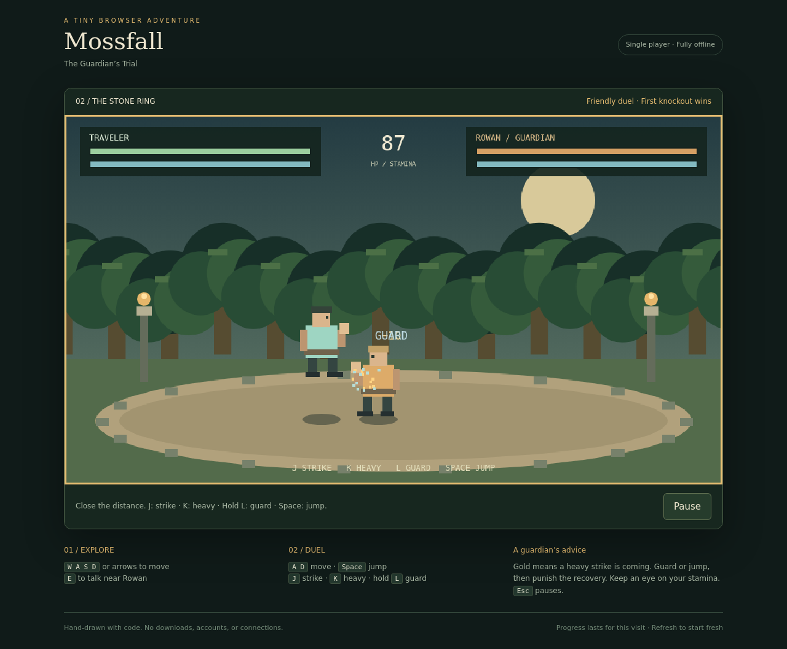

# Mossfall — The Guardian’s Trial

A small, single-player RPG and fighting game built entirely with HTML, CSS, and JavaScript. Explore a forest village, talk to Rowan, and challenge the guardian to a friendly duel.

## Play locally

Download or clone this repository and open `index.html` in a modern browser. No build, installation, server, database, API keys, or internet connection is required. All art is drawn with the Canvas API, and all game code and styles are embedded in the HTML file.

## Controls

| Action | Keyboard |
| --- | --- |
| Explore | WASD or arrow keys |
| Talk to Rowan nearby | E |
| Move during a duel | A / D or left / right arrows |
| Jump | Space, W, or up arrow |
| Strike | J |
| Heavy attack | K |
| Guard | Hold L |
| Pause | Escape or the Pause button |

On-screen controls are available on small screens and touch devices.

## Gameplay

Approach Rowan at the stone circle and accept his challenge. Manage your health and stamina, watch for gold heavy-attack wind-ups, and block or jump before counterattacking. The duel ends in a knockout or after 90 seconds; the fighter with more health wins when time expires. Rematch or return to the village afterward. Wins and losses last for the current visit; refreshing resets the game.

## Project files

- `index.html`: the complete game, including HTML, CSS, JavaScript, and procedural artwork.
- `screenshots/`: desktop village, duel, and mobile previews.

## Verification

Tested in headless Chromium using Python Playwright. All 25 checks passed, covering exploration, dialogue, keyboard combat, AI attacks, guard and stamina mechanics, jumping, pause/resume, rematches, mobile layout, and on-screen movement. Controlled game states exercised victory and defeat screens. No JavaScript runtime errors or HTTP/API requests were observed during the run.

## Current scope

One village and one AI opponent. There is no persistent save system, multiplayer, or audio.
