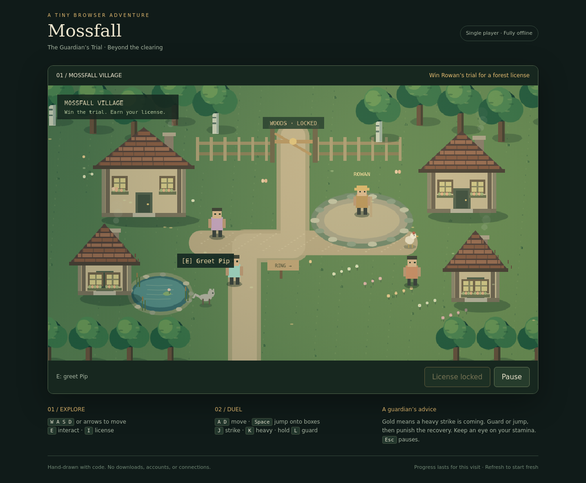
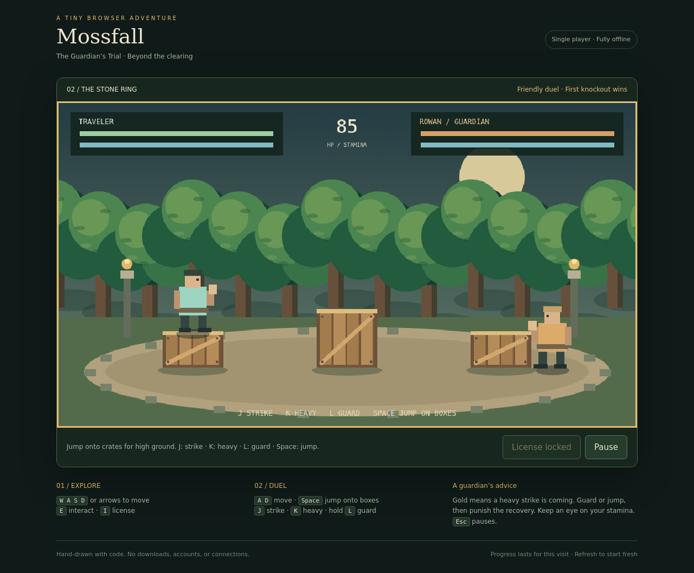
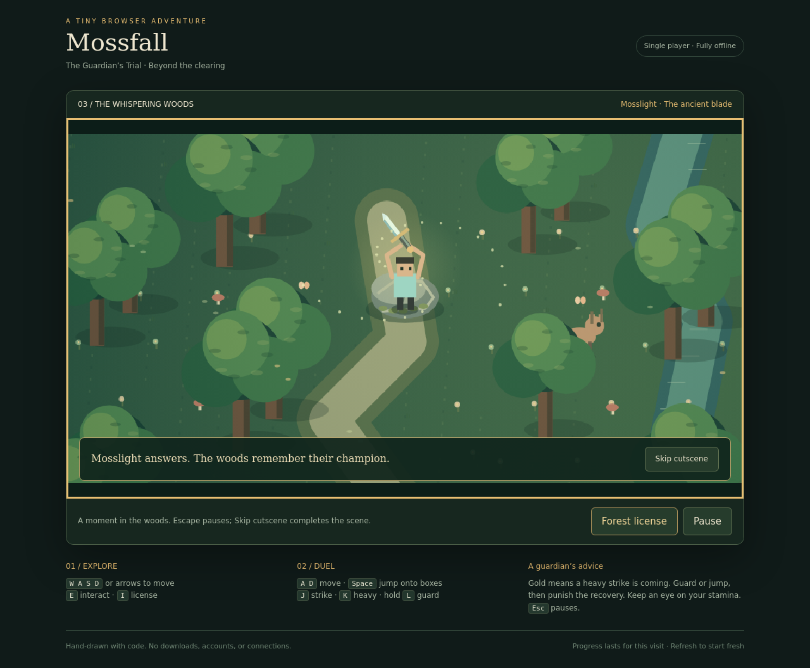
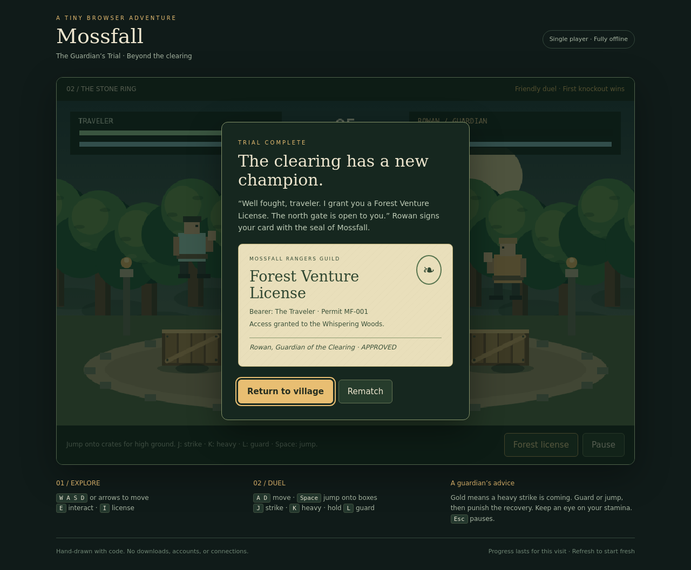
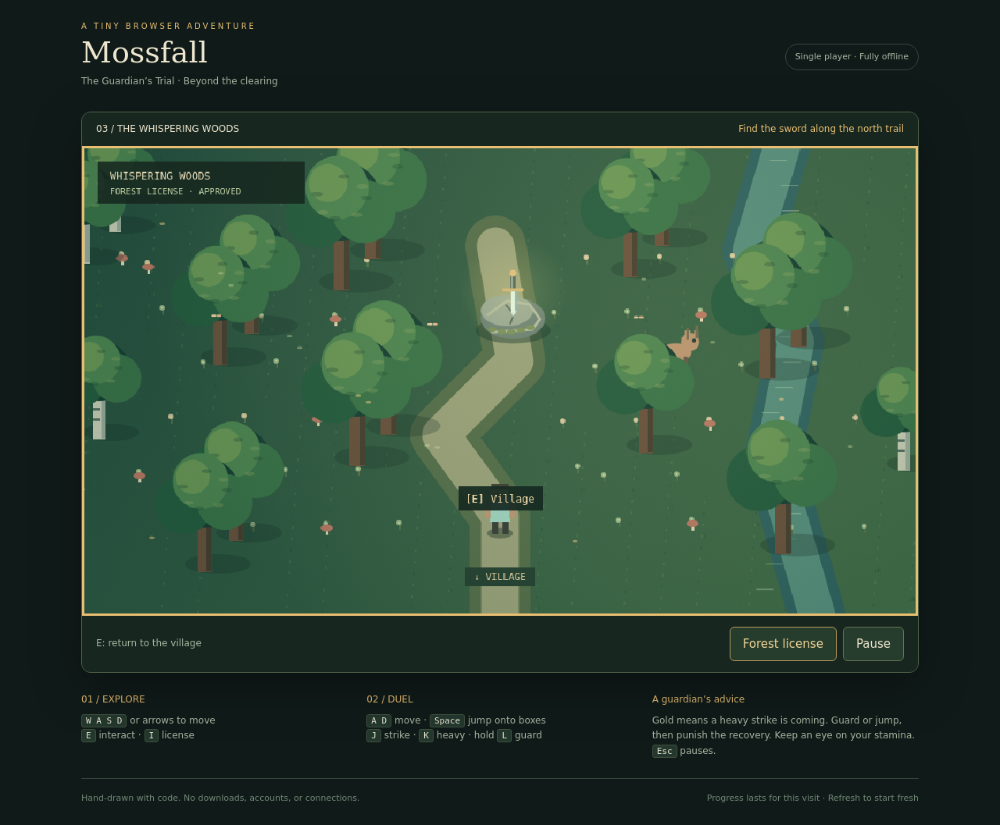

# Mossfall — The Guardian’s Trial

A small, single-player RPG and fighting game built entirely with HTML, CSS, and JavaScript. Explore a lively forest village, challenge its guardian, and earn your license to venture into the Whispering Woods.



**[Play Mossfall in your browser](https://orw-10.github.io/mossfall/)**

## Play locally

Download or clone this repository and open `index.html` in a modern browser. No build, installation, server, database, API keys, or internet connection is required. The game, styles, and procedural artwork are contained in one HTML file.

## Play online

**[Play Mossfall](https://orw-10.github.io/mossfall/)** — no installation or account required.

The game is hosted with GitHub Pages from `main` at the repository root. Updates pushed to `main` deploy automatically. Pages serves static files; gameplay runs entirely in your browser, with no backend, database, or API keys. You can also download `index.html` to play offline.

## Controls

| Action | Keyboard |
| --- | --- |
| Explore | WASD or arrow keys |
| Talk, greet animals, use a gate/trail, or inspect the sword | E near the target |
| Inspect earned forest license | I or the Forest license button |
| Move during a duel | A / D or left / right arrows |
| Jump onto / off arena crates | Space, W, or up arrow |
| Strike | J |
| Heavy attack | K |
| Guard | Hold L |
| Pause | Escape or the Pause button |

On-screen controls are available on small screens and touch devices.

## The adventure

Explore a village with tiled cottages, smoking chimneys, flower beds, a lily pond, birch trees, drifting leaves, and butterflies. Mira the herbalist and Bram the woodcutter walk around the village and offer advice. Greet Pip the cat and Clover the chicken with **E** nearby to see their reactions.

Approach Rowan at the stone circle and accept his challenge. Manage health and stamina, watch for gold heavy-attack wind-ups, and block or jump before counterattacking. Three solid wooden crates create raised fighting platforms. Jump onto or off them, guard on top, and use the height difference to evade attacks. Rowan can jump across the crates to pursue you. The duel ends in a knockout or after 90 seconds; the fighter with more health wins at timeout. A draw or defeat does not award a license.

Your first victory grants a signed **Forest Venture License**. Inspect it with **I**, then approach the north gate and press **E** to enter the Whispering Woods. Explore its winding trail, stream, mushrooms, and wildlife; greet Fern the deer or Ember the fox. Use **E** at the south trail sign to return to Mossfall. You may rematch Rowan, and later losses do not revoke your license.

Follow the north forest trail to discover **Mosslight**, a sword embedded in a mossy stone. Press **E** nearby and choose **Pull the sword** for a short animated sequence: the traveler approaches, struggles with the hilt, breaks the seal, and raises the blade in a burst of light. You may pause with **Escape** or choose **Skip cutscene** to receive the sword immediately. The sword is carried visibly during exploration and can be inspected with the **Mosslight sword** button. It can only be claimed once per visit; training duels with Rowan remain unarmed.





The sword, license, and duel scores last for the current visit. Refreshing resets the game. There is no persistent save system, multiplayer, or audio.





## Project files

- `index.html`: the complete offline game, including HTML, CSS, JavaScript, and procedural artwork.
- `screenshots/`: desktop, forest, license, and mobile previews.
- `tests/test_game.py`: repeatable Playwright regression checks.
- `tests/requirements.txt`: optional development dependencies; not required to play.
- `.nojekyll`: enables direct static-file hosting with GitHub Pages.

## Browser verification

Install the optional test tools in a Python virtual environment, then run from the repository root:

```sh
python -m pip install -r tests/requirements.txt
python -m playwright install --with-deps chromium
python tests/test_game.py
```

Tested in headless Chromium. Checks cover movement, NPC dialogue, animal reactions, AI combat, guard and stamina mechanics, jumping, pause/resume, rematches, license rewards, locked forest access, return travel, mobile controls and layout, crate collisions and landings, platform jumping and blocking, Rowan’s jumping behavior, sword acquisition, full cutscene playback, cutscene pause/skip, and session reset. Controlled game states cover win/loss/draw reward boundaries. Screenshots are regenerated in `screenshots/`. No HTTP/API requests or JavaScript runtime errors are expected.
